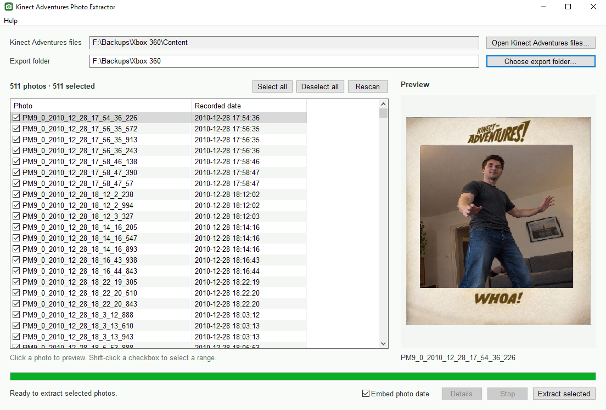

<div align="center">
  

  <h1>Kinect Adventures Photo Extractor</h1>

  <div>
    <a href="https://github.com/NightMean/kinect-adventures-photo-extractor/releases/latest"></a>
    <a href="https://github.com/NightMean/kinect-adventures-photo-extractor/releases"></a>
    <a href="https://www.buymeacoffee.com/nightmean"></a>
    <a href="LICENSE"></a>
  </div>
</div>

## What it is

Recover photos embedded in Xbox 360 **Kinect Adventures!** save files. Scan an
exported Xbox folder and extract selected images as ordinary JPG files.

## Features

- Automatically searches the selected folder and its subfolders for Kinect
  Adventures photo saves.
- Embeds a valid date from a `PM9_*` filename into JPEG EXIF by default, without
  recompressing the image. Uncheck **Embed photo date** to preserve the original
  JPEG bytes.
- Keeps existing photos and source files unchanged; identical exports are
  skipped on reruns.

## Screenshots



## How to use

### Windows app

Download [`KA_Photo_Extractor.exe` from the latest release](https://github.com/NightMean/kinect-adventures-photo-extractor/releases/latest).

1. Click **Open Kinect Adventures files…** and choose the main folder containing
   your exported Xbox files. The app searches subfolders automatically.
2. Choose an **Export folder** on your PC.
3. Review the discovered photos, preview them, and check the ones you want.
4. Click **Extract selected**. Progress and the saved, existing, and failed
   counts appear in the window.

> [!NOTE]
> The app writes a `recovery-report.json` beside the exported photos. It
> contains relative source filenames and recovery results.

### Python CLI (Linux or terminal)

Requires Python 3.10+ and Git. Install the CLI directly from GitHub:

```sh
python -m pip install git+https://github.com/NightMean/kinect-adventures-photo-extractor.git
kinect-photos "/path/to/Content" --recursive --output photos.zip
```

The CLI extracts recovered photos into a ZIP archive.

<details>
<summary>CLI arguments and options (<code>--help</code>)</summary>

| Argument | Description |
| --- | --- |
| `inputs` | One or more exported photo files or directories. Directories are scanned when `--recursive` is set. |
| `-o`, `--output ZIP` | Required destination ZIP. Existing files are never overwritten. |
| `-r`, `--recursive` | Include files in input directories and their subdirectories. |
| `-V`, `--version` | Show the program version and exit. |
| `-h`, `--help` | Show command-line help and exit. |

</details>

---

### Copy files from your Xbox 360

These steps are also available in the app under **Help → Export guide**.

1. In Xbox 360 **Storage/Memory** settings, open the device containing your
   **Kinect Adventures!** photo saves and copy them to a USB drive. If the saves
   are already on a USB drive, use that drive.
2. Choose the option that matches the USB drive's format:

   - **Option 1 — newer external USB format:** Xbox's April 2015 system update added
     external USB storage support up to 2 TB. For a drive using this newer
     format, connect it to a PC and copy its `Content` folder in File Explorer.
     If Windows does not show the files, use Option 2.
     See [Xbox Wire's 2015 update](https://news.xbox.com/en-us/2015/04/30/xbox-360-system-update-now-available-adds-support-for-2tb-hard-drives/)
     and [FATXplorer's format notes](https://fatxplorer.eaton-works.com/2015/06/09/2-5-4-now-available/).
   - **Option 2 — legacy FATX/XTAF format:** If File Explorer cannot show the individual
     saves, use a storage browser such as [USB XTAF Explorer](https://gruntmods.com/usb-xtaf-explorer/)
     to copy the Kinect Adventures files or the `Content` folder. This is a
     discontinued utility. The drive's format, not the age of the photos,
     determines whether this step is needed. Do not format the drive to extract
     photos.

3. Copy the entire `Content` folder to your PC. The app automatically searches
   it and its subfolders for the photos.

   For reference, Kinect Adventures! saves are usually under
   `Content/<profile>/4D5308ED/00000001` and have filenames beginning with
   `PM9_` (usually without a `.jpg` extension). `4D5308ED` is the game's title
   ID. Raw disk images are not supported.
4. In the app, select the copied folder, choose an **Export folder**, and
   extract the photos.

### Run the GUI from Python source

Requires Python 3.10+, wxPython, and Pillow. From the repository root:

```sh
python -m pip install -r requirements.txt
python KinectPhotos.pyw
```

For the optional ZIP command-line extractor:

```sh
python -m kinect_photos path/to/exported/Content --recursive -o photos.zip
python -m kinect_photos --help
```

## Limitations

- Select exported individual Xbox files or their containing folders. The app
  does not read raw USB/disk images or ZIP archives.
- Recovery finds complete, contiguous JPEG data. It cannot reconstruct missing
  or fragmented data, or decode `SouvenirRecording` animations.
- `GameProgress` saves and unrelated games are not photo sources and are
  excluded from discovery.
- Dates come from the Xbox clock encoded in a `PM9_*` filename and may be wrong.
  If that date is invalid, the list can show a file-modified date instead; this
  may reflect when files were copied to a backup.
- Preview decoding is optional. A photo that cannot be previewed may still be
  recoverable as a complete JPEG.
- The GUI is packaged and supported on Windows. Linux and macOS GUI launch have
  not been verified.

## Contributing

Bug reports, documentation improvements, and pull requests are welcome. Please
avoid including personal Xbox saves or recovered photos in issues or changes.
Use [GitHub Issues](https://github.com/NightMean/kinect-adventures-photo-extractor/issues)
for bugs and questions, and submit changes through
[GitHub Pull Requests](https://github.com/NightMean/kinect-adventures-photo-extractor/pulls).

From the repository root, install the build dependencies, run the tests, and
build the Windows app with:

```sh
python -m pip install -e ".[build]"
python -m unittest discover -s tests -v
python tools/build_windows.py
```

The executable is written to `dist/desktop/KA_Photo_Extractor.exe`.

## Support the project

If this tool helped recover your photos, you can support its continued development:

<p align="center">
  <a href="https://github.com/sponsors/NightMean"></a>&nbsp;
  <a href="https://www.buymeacoffee.com/nightmean"></a>&nbsp;
  <a href="https://ko-fi.com/nightmean"></a>
</p>

## License

Licensed under the [MIT License](LICENSE).

This independent project is not affiliated with, endorsed by, or sponsored by
Microsoft or Xbox.
